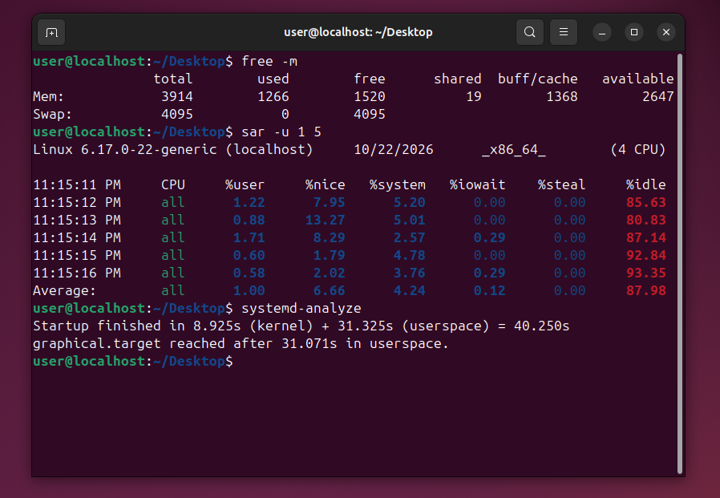
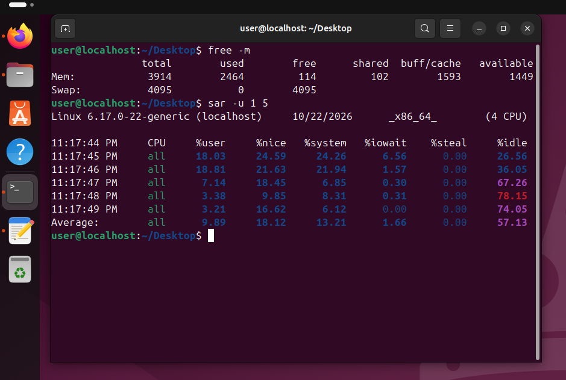
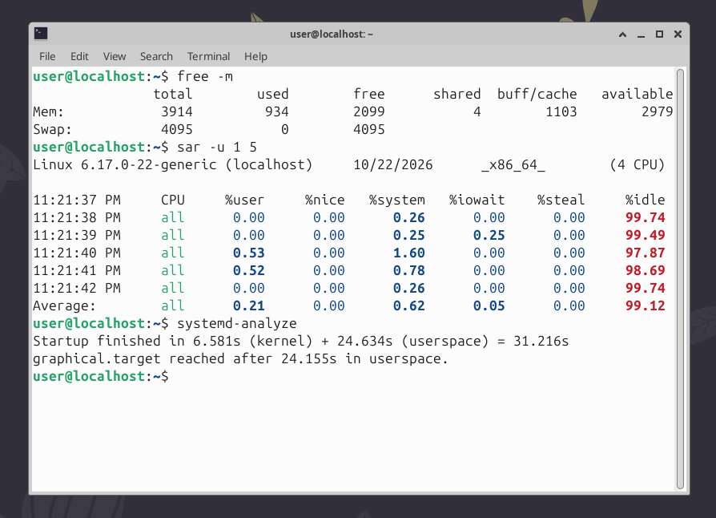
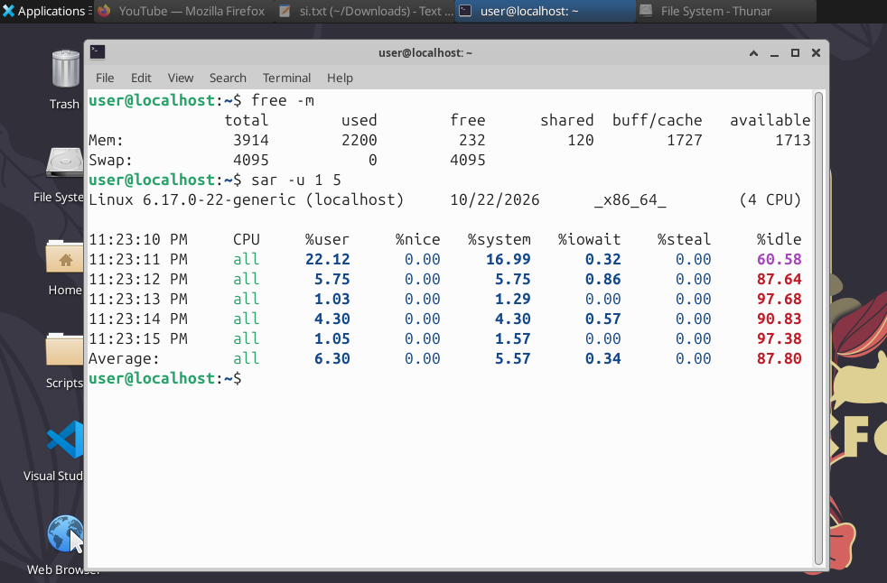

# Linux Desktop Performance: GNOME vs XFCE

[](LICENSE)
[](https://releases.ubuntu.com/24.04/)
[](https://kernel.org/)
[](https://www.virtualbox.org/)
[](https://www.gnome.org/)
[](https://xfce.org/)
[](report/linux_desktop_benchmark_report.pdf)

Comparative benchmark analyzing resource consumption and compositor stability across GNOME 46 and XFCE 4.18 on a virtualized developer workstation.

**Test environment:** Ubuntu 24.04.4 LTS, VirtualBox 7.x, Kernel 6.17.0-22-generic, 4 vCPUs, 4 GB RAM.

---

## Key Results

| Metric | GNOME 46 | XFCE 4.18 | Delta |
|---|---|---|---|
| Idle RAM | 1,266 MB | 934 MB | **-26.2%** |
| Active RAM (IDE + Tools) | 2,464 MB | 2,200 MB | **-10.7% (-264 MB)** |
| Available headroom (active) | 1,449 MB | 1,713 MB | **+18.2%** |
| Active CPU %system | 13.21% | 5.57% | **-7.64 pp (>57% reduction)** |
| Active CPU %idle | 57.13% | 87.80% | **+30.67 pp** |
| Total boot time | 40.250 s | 31.216 s | **-22.4%** |

---

## Technical Report

📄 [linux_desktop_benchmark_report.pdf](report/linux_desktop_benchmark_report.pdf)

The complete report details:
- Architectural differences between GNOME Mutter (Wayland/X11 compositor) and XFCE Xfwm4.
- Mitigation of boot deadlocks caused by `drm_fb_helper_damage_work` soft lockups under VirtualBox on kernel 6.17.0-22-generic.
- Telemetry across N=3 cold-boot iterations with a variance of ±15 MB.
- Workstation tradeoffs across memory footprint, kernel context switching, and display compositing.

---

## Raw Telemetry

### GNOME 46: Idle Baseline
`free -m`: 1,266 MB used | `sar`: %system 4.24%, %idle 87.98% | boot: 40.250 s



---

### GNOME 46: Active Workload (VSCode, LSP, Linter)
`free -m`: 2,464 MB used | `sar`: %system 13.21%, %idle 57.13%



---

### XFCE 4.18: Idle Baseline
`free -m`: 934 MB used | `sar`: %system 0.62%, %idle 99.12% | boot: 31.216 s



---

### XFCE 4.18: Active Workload (VSCode, LSP, Linter)
`free -m`: 2,200 MB used | `sar`: %system 5.57%, %idle 87.80%



---

## Reproduction

**Environment:** Ubuntu 24.04.4 LTS, VirtualBox 7.x, 4 vCPUs, 4 GB RAM, VBoxSVGA display adapter (3D acceleration disabled).

```bash
# 1. Install XFCE and monitoring utilities
sudo apt update && sudo apt install -y xfce4 xfce4-goodies lightdm lightdm-gtk-greeter sysstat

# 2. Mask Plymouth services to avoid the DRM framebuffer lockup
sudo systemctl mask plymouth-start.service plymouth-quit-wait.service

# 3. Strip splash from GRUB
# Set GRUB_CMDLINE_LINUX_DEFAULT="quiet" in /etc/default/grub
sudo update-grub

# 4. Collect baseline metrics
free -m
sar -u 1 5
systemd-analyze
```

**Display configuration:**
- Disable Hardware 3D Acceleration in VirtualBox VM settings.
- Disable compositing in XFCE: `Settings > Window Manager Tweaks > Compositor` and uncheck `Enable display compositing`.

---

## License

This project is licensed under the MIT License. See [LICENSE](LICENSE) for details.

---

## Author

**Davide Torelli** | Cybersecurity Master Student, AI Governance & Cloud Compliance  
*Version 1.0 (October 2026)*